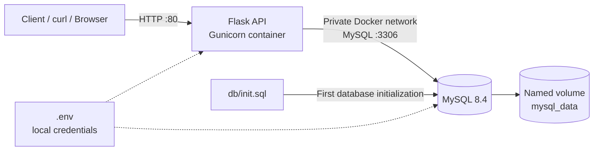

# Dockerization of Bookstore API — Flask & MySQL

<p align="center">
  
  
  
  
  
</p>

A containerized Bookstore REST API built with **Python, Flask, and MySQL**. Docker Compose runs the API and database as separate services, while a named volume keeps database data persistent. The project is designed as a practical cloud/DevOps exercise and can be deployed to an AWS EC2 instance.

## Architecture



- **API:** Flask application served by Gunicorn.
- **Database:** MySQL 8.4, reachable only on the internal Compose network.
- **Persistence:** Docker named volume `mysql_data`.
- **Initialization:** `db/init.sql` creates the books table and inserts sample records on first database initialization.
- **Configuration:** Credentials and runtime settings are read from a local `.env` file.

## Project structure

```text
.
├── bookstore-api.py       # Flask REST API
├── requirements.txt       # Python dependencies
├── Dockerfile             # Non-root API container image
├── docker-compose.yml     # API + MySQL orchestration
├── .env.example           # Safe configuration template
├── .gitignore
├── .dockerignore
├── db/
│   └── init.sql           # Database schema and sample data
└── README.md
```

## Prerequisites

- Docker Engine and the Docker Compose plugin
- Git
- An available local TCP port (default: `80`)

## Run locally

### 1. Clone the repository

```bash
git clone https://github.com/ramznagc/dockerization-bookstore-api-on-python-flask-mysql.git
cd dockerization-bookstore-api-on-python-flask-mysql
```

### 2. Configure credentials

Copy the example file:

```bash
cp .env.example .env
```

Edit `.env` and replace both password placeholders with different, strong random values. For example, generate values locally with:

```bash
openssl rand -hex 24
```

Use one generated value for `DB_PASSWORD` and another for `MYSQL_ROOT_PASSWORD`. Do not commit `.env`.

### 3. Build and start the services

```bash
docker compose up --build -d
```

Check service status and logs:

```bash
docker compose ps
docker compose logs -f api
docker compose logs -f database
```

The API is available at:

- Home: http://localhost/
- Health check: http://localhost/health
- Books: http://localhost/books

The database is not published to the host. The API connects to it through the private Compose network using the service hostname `database`.

### 4. Stop the services

```bash
docker compose down
```

This keeps the named database volume. To delete the database and all persisted book data as well:

```bash
docker compose down -v
```

> **Warning:** `docker compose down -v` permanently removes the project's MySQL volume. Use it only when you intentionally want to reset the database.

## REST API

All request and response bodies use JSON.

| Method | Endpoint | Description |
|---|---|---|
| GET | `/` | API welcome message |
| GET | `/health` | API and database health check |
| GET | `/books` | List all books |
| GET | `/books/{book_id}` | Retrieve one book |
| POST | `/books` | Create a book |
| PUT | `/books/{book_id}` | Update a book |
| DELETE | `/books/{book_id}` | Delete a book |

### Example requests

List books:

```bash
curl http://localhost/books
```

Get one book:

```bash
curl http://localhost/books/1
```

Create a book:

```bash
curl -X POST http://localhost/books \
  -H "Content-Type: application/json" \
  -d '{"title":"The Pragmatic Programmer","author":"Andrew Hunt and David Thomas"}'
```

Update a book:

```bash
curl -X PUT http://localhost/books/1 \
  -H "Content-Type: application/json" \
  -d '{"is_sold":true}'
```

Delete a book:

```bash
curl -X DELETE http://localhost/books/1
```

## Security and reliability choices

- **No hard-coded database password:** Credentials are provided through environment variables and kept in the ignored `.env` file.
- **Parameterized SQL:** User-supplied values are passed as query parameters to reduce SQL injection risk.
- **Input validation:** Request bodies, field types, and maximum field lengths are checked.
- **Non-root container:** The API process runs as an unprivileged user.
- **Production WSGI server:** Gunicorn serves Flask; the development server is not used in the container.
- **Private database:** MySQL has no host-published port; only the API joins the database network.
- **Health-aware startup:** Compose waits for the database health check before starting the API.
- **Persistent storage:** MySQL data is stored in a named volume.
- **Safe repository defaults:** `.env`, Python caches, logs, and Terraform state are excluded from Git.

> This is a learning/development deployment, not a complete production security baseline. For production, add TLS termination, managed secrets, backups, database least-privilege review, image scanning, dependency updates, monitoring, and a controlled network ingress.

## Deploy to AWS EC2 (high-level)

The original project brief describes an AWS EC2 deployment with Terraform and a user-data script. Terraform files were not included in the supplied project files, so this repository currently contains the containerized application stack only.

For a manual EC2 demonstration:

1. Launch a supported Linux EC2 instance and install Docker Engine plus the Compose plugin.
2. Allow inbound HTTP on TCP 80 only as broadly as your demo requires; restrict SSH (TCP 22) to your own trusted IP.
3. Clone this repository on the instance.
4. Create a secure `.env` file on the instance; do not place credentials in user data, source code, or Git.
5. Run `docker compose up --build -d` and verify `/health`.

For a repeatable infrastructure deployment, add and review Terraform configuration separately. Do not commit Terraform state files or cloud credentials.

## Troubleshooting

**API cannot connect to MySQL**

```bash
docker compose ps
docker compose logs database
docker compose logs api
```

Confirm that `.env` contains matching `DB_USER` and `DB_PASSWORD` values and that the database service becomes healthy.

**Port 80 is already in use**

Set another host port in `.env`, for example `APP_PORT=8080`, then recreate the stack:

```bash
docker compose up --build -d
```

Open http://localhost:8080/ afterwards.

**Database initialization changes do not appear**

MySQL initialization scripts run only when the data directory is first initialized. Existing named volumes are not re-seeded automatically. Back up data before resetting; deleting the volume removes stored records.

## Learning outcomes

- Build a Flask REST API backed by MySQL.
- Containerize a Python service with a Dockerfile.
- Orchestrate application and database services with Docker Compose.
- Configure service networking, health checks, environment variables, and persistent volumes.
- Apply practical application and container security improvements.
- Prepare a containerized application for an AWS EC2 deployment workflow.

## References

- [Flask documentation](https://flask.palletsprojects.com/)
- [PyMySQL documentation](https://pymysql.readthedocs.io/)
- [Docker Compose documentation](https://docs.docker.com/compose/)
- [MySQL Docker image documentation](https://hub.docker.com/_/mysql)
- [Gunicorn documentation](https://docs.gunicorn.org/)
- [AWS EC2 documentation](https://docs.aws.amazon.com/ec2/)

---

<p align="center"><i>Built as a hands-on Docker, Flask, MySQL, and AWS learning project.</i></p>
